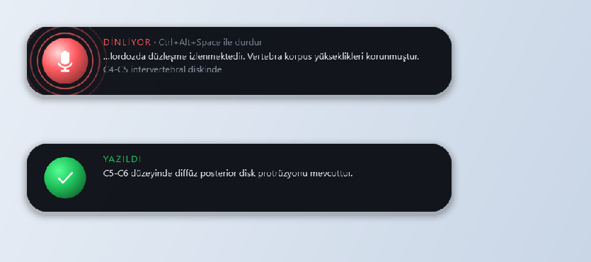
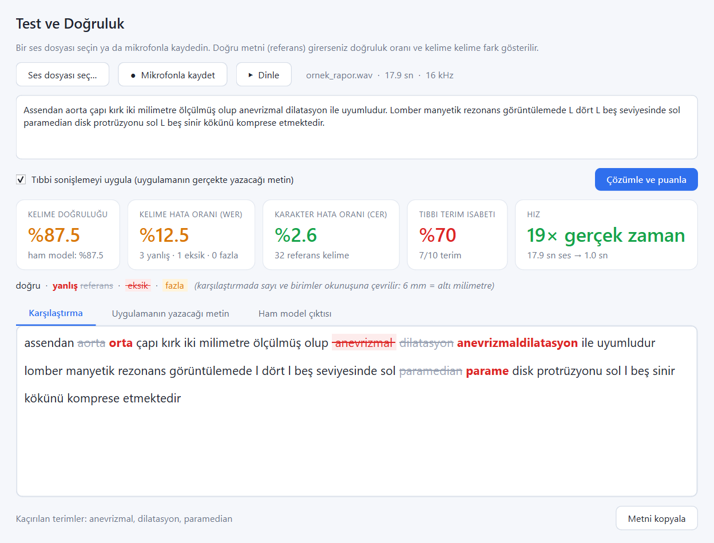
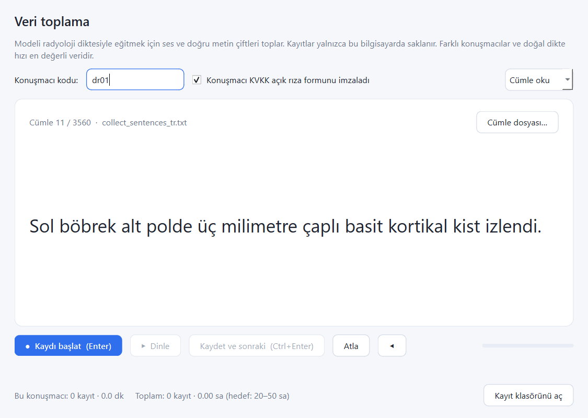

# Tıbbi Dikte

Windows'ta **imlecin bulunduğu herhangi bir alana** (Word, HBYS, tarayıcı formu…) Türkçe konuşmayı yazan
dikte uygulaması. Radyoloji ve genel tıbbi terimler için ayarlanmıştır, **tamamen çevrimdışı** çalışır
(ses bilgisayardan çıkmaz — KVKK), ürün anahtarıyla lisanslanır.



## Özellikler
- **Her uygulamaya yazar**: Unicode tuş olayları (ş, ğ, ı, İ doğru), pano değişmez.
- **Anlık yazım**: kelimeler konuşurken yazılır; cümle sonunda düzeltilmiş hâliyle yalnızca farklı kısım güncellenir.
- **İki dikte modu**: aç/kapa kısayolu (**Ctrl+Alt+Space**) ve **bas-konuş** (Boşluk'u basılı tut; kısa basış normal boşluk yazar).
- **Dinleme göstergesi**: ekranın altında sesle atan nabız + canlı metin; odak çalmaz.
- **Tıbbi sonişleme**: terim düzeltme, sayı/birim (`beş yüz miligram → 500 mg`), omurga seviyesi onarımı (`G4 C5 → C4-C5`), sağ/sol (`son L5 → sol L5`).
- **Sesli biçim komutları**: "yeni satır" / "alt satıra geç" / "satır başı" (yeni satır), "yeni paragraf" /
  "paragraf başı" (boş satır bırakıp yeni paragraf), "yeni madde" (•).
- **Söyleniş varyantlı sözlük**: her terime modelin duyabileceği söylenişler bağlanır (`BT ← bete, pete`);
  dışa/içe aktarma (Excel'de açılan CSV).
- **Test ve doğruluk ekranı**: **canlı dikte editörü** (metin doğrudan editöre yazılır; yanlış kelimeyi seç › sağ tık ›
  *Sözlüğe varyant olarak ekle*) ve ses dosyası/kayıt + doğru metin → kelime doğruluğu, WER/CER, terim isabeti,
  renkli fark.
- **Veri toplama ekranı**: radyologlardan eğitim verisi (ses + metin), KVKK onayı ve kalite kontrolüyle.
- **Değiştirilebilir model**: `model.json` ile her sherpa-onnx modeli kodsuz eklenir.
- **Lisanslama**: makineye bağlı çevrimdışı Ed25519 ürün anahtarları + her bilgisayarda çalışan süreli **demo anahtarı**.

| Test ve doğruluk | Veri toplama |
|---|---|
|  |  |

## Kullanım
1. Kur → **Ayarlar › Lisans**'a ürün anahtarını gir (ya da makine kodunu satıcıya ilet).
2. Yazmak istediğin alana tıkla →
   - **Ctrl+Alt+Space** → konuş → **Ctrl+Alt+Space**, veya
   - **Boşluk'u basılı tut** → konuş → bırak.
3. Tepsi menüsü: **Test ve doğruluk…**, **Veri toplama…**, **Ayarlar…** (model, mikrofon, kısayol, bas-konuş tuşu,
   anlık yazım, sözlük).
4. **Ayarlar › Sözlük**: tablo — *Doğru yazım* + *Söyleniş varyantları* (virgülle; `kök*` biçimi ekleri korur:
   `protrüzyon ← protezyon*`). Varyant bir sesli komuta da bağlanabilir (`alt satıra geç ← alt sağa geç`).
   **Dışa aktar…** / **İçe aktar…** ile sözlük başka bilgisayara taşınır; içe aktarma mevcut sözlüğü silmeden birleştirir.

## Tıbbi doğruluk katmanları
| Katman | Örnek |
|---|---|
| Hotword (genel tıbbi + rapor sıklığından 493 radyoloji terimi) | modele terimler öncelikli tanıtılır |
| Kesin / kök düzeltme (`corrections_tr.tsv`) | `e ka ge → EKG`, `kemik eriği → kemik iliği`, `protezyonu → protrüzyonu` |
| Bölünmüş kelime birleştirme | `para santralin → parasantralin`, `sekanslar da → sekanslarda` |
| Bağlamsal düzeltme (rapor metinlerinden 3-gram dil modeli) | `sol bacağı yayılan → sol bacağa yayılan` |
| Sayı ve birim (ITN) | `beş yüz miligram → 500 mg`, `tansiyon yüz kırk doksan → 140/90` |
| Omurga seviyesi + sağ/sol | `C5G 6 → C5-C6`, `4C5 → C4-C5`, `son L5 → sol L5` (T1/T2 sekanslarına dokunulmaz) |
| Bulanık terim düzeltme (raporda geçen kelimeler korunur) | `Tropolin → Troponin`, `intrabenoz → intravenöz` |

Ölçümler (`tests/eval_wer.py`, `tests/cases/score_cases.py`):

| Set | Ham model | Uygulama çıktısı |
|---|---|---|
| Radyoloji (50 cümle × 2 sentetik ses) | WER %21,9 | **%16,1** |
| Genel tıbbi (12 cümle × 2 sentetik ses) | WER %19,9 | **%10,6** |
| Gerçek kullanıcı denemesi — servikal MR | doğruluk %81,3 | **%98,8** (terim %100) |

Yeni gerçek deneme eklemek: `tests/cases/<ad>.hyp.txt` (model çıktısı) + `<ad>.ref.txt` (doğru metin).

## Model eğitimi
`training/` — mihu modelinin ONNX dosyalarından PyTorch checkpoint'i kurtarma (doğrulanmış), veri hazırlama
(ISSAI, Common Voice, MediaSpeech, FLEURS, kendi kayıtlar), ince ayar, kendi Türkçe BPE ile sıfırdan eğitim ve
uygulamaya dışa aktarma. Ayrıntı ve komutlar: **[docs/EGITIM.md](docs/EGITIM.md)**.

- **A yolu**: mihu üzerine radyoloji ince ayarı (hızlı; mihu izni ve atıf gerekir). Sonuç (Chatterbox ile
  seslendirilmiş radyoloji cümleleri + genel Türkçe; kelime hatası):

  | Model | Radyoloji (uygulama) | Genel tıbbi (uygulama) | FLEURS (ham) | ISSAI (ham) |
  |---|---|---|---|---|
  | v2 (taban) | %15,6 | %11,9 | %9,1 | %11,3 |
  | **`models/tibbi-tr-v3-tam`** (14.750 klip) | **%1,6** (terim %99) | %8,4 | %8,3 | %9,3 |
  | `models/tibbi-tr-v3-aday` (10.888 klip) | %2,3 (terim %98) | %5,0 | %7,8 | %9,3 |
- **B yolu**: mihu'dan bağımsız kendi modelimiz (kendi BPE, sıfırdan; `--independent` dışa aktarımda atıf eklenmez).

## Model değiştirme
Her model `models/<klasör>/model.json` ile tanımlanır; uygulama `models/` ve `%APPDATA%\TibbiDikte\models`
klasörlerini tarar, **Ayarlar › Genel › Konuşma modeli**'nden seçilir:

```json
{ "name": "Whisper small", "engine": "sherpa-onnx", "mode": "offline", "type": "whisper",
  "encoder": "small-encoder.int8.onnx", "decoder": "small-decoder.int8.onnx",
  "tokens": "small-tokens.txt", "language": "tr" }
```
`mode`: `online` (akış) | `offline` (Silero VAD ile bölünür). `type`: online için `transducer`, `paraformer`,
`zipformer2_ctc`; offline için `transducer`, `whisper`, `nemo_ctc`, `paraformer`, `sense_voice`.
Lisansı atıf gerektiren modellerde `"attribution"` alanı Hakkında sekmesinde ve NOTICE.txt'de gösterilir.

## Lisans anahtarları (yalnızca satıcı)
```powershell
python tools\keygen.py init                                                   # bir kez: imza anahtar çifti
python tools\keygen.py issue ABCD-EFGH-IJKL-MNOP --customer "Dr. X" --days 365  # makineye bağlı
python tools\keygen.py issue --demo --customer "Y Hastanesi (demo)" --days 14   # her bilgisayar, en fazla 31 gün
```
`tools/private_key.pem` **gizlidir** (`.gitignore`'da): yedekleyin, paylaşmayın. Verilen anahtarlar
`tools/issued_keys.csv`'ye kaydedilir. Demo akışı: **[docs/DEMO.md](docs/DEMO.md)**.

## Geliştirme
```powershell
py -3.11 -m venv .venv; .\.venv\Scripts\pip install -r requirements-dev.txt
.\.venv\Scripts\python tools\setup_model.py      # modeli indir + bpe.vocab + model.json
.\.venv\Scripts\python tools\keygen.py init      # kendi imza anahtarınız
.\.venv\Scripts\python -m app.main               # çalıştır
.\.venv\Scripts\python -m pytest                 # testler
.\build.ps1                                      # dist\installer\TibbiDikte-Kurulum-*.exe
```

```
app/            uygulama (tepsi, gösterge, dikte, anlık yazım, bas-konuş, test, veri toplama, lisans)
app/engines/    STT motor arayüzü + sherpa-onnx
app/medical/    sözlükler, düzeltmeler, sonişleme, bağlamsal dil modeli
tools/          model kurulumu, anahtar üretici, sözlük üretimi, test kaydı
training/       checkpoint kurtarma, veri hazırlama, eğitim, dışa aktarma
tests/          birim testleri, değerlendirme, gerçek vaka puanlaması
```

## Model lisansı
Varsayılan konuşma tanıma modeli **mihu Community License** kapsamındadır: yıllık ciro < 500.000 USD iken
ticari kullanım; ücretli üründe dağıtım açıkça izinli değildir (md. 5e); atıf zorunludur (Hakkında sekmesi ve
NOTICE.txt). v2 ağırlıkları bu depoda yer almaz (`tools/setup_model.py` indirir); radyoloji ince ayarlı
v3 modelleri (`models/tibbi-tr-v3-tam`, `models/tibbi-tr-v3-aday`) depoyla gelir. Satış ve müşteriye kurulum
vermeden önce mihu'dan yazılı izin alınmalıdır; mihu'dan bağımsız model (B yolu) bu kısıtı kaldırır.
